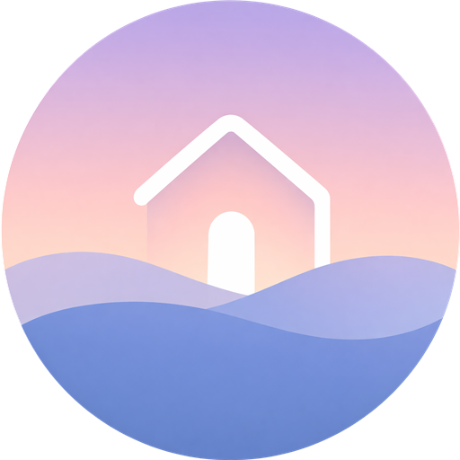
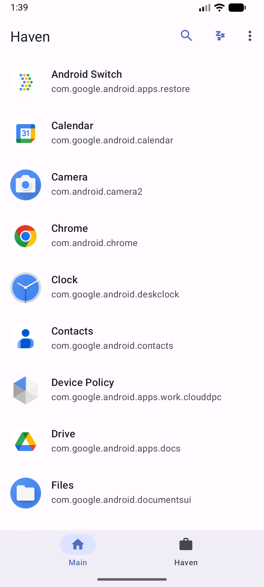
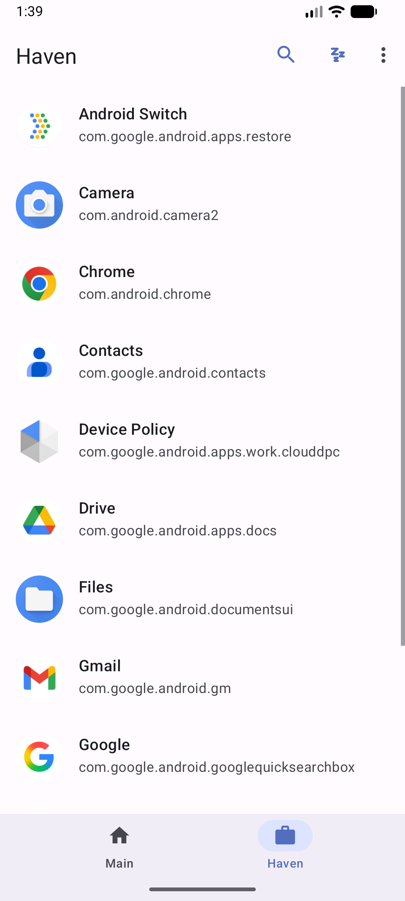
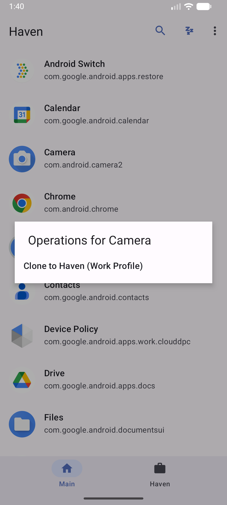

# Haven

[](https://github.com/Kenneth-Cho-InfoSec/Haven/actions/workflows/android-ci.yml)


<p align="center">
  
</p>

Haven is a Free and Open-Source Android **Home Launcher & Work Profile Isolation** app. Originally a modernized fork in the Shelter / Island lineage, Haven brings together a customizable daily Android launcher and managed Work Profile app isolation inside a single modular application (`com.arcturus.haven`) built for modern Android releases with a Material Design 3 Expressive UI.

Haven installs as a separate app under `com.arcturus.haven` and does not upgrade or replace existing installs of Shelter, Island, or other Work Profile managers.

## Overview

- **Problem:** Android Work Profile isolation tools keep untrusted or noisy apps contained, but legacy Shelter / Island codebases need current SDK targeting, dependency upkeep, hardened cross-profile IPC, and smoother day-to-day launcher workflows to stay practical on modern devices.
- **Approach:** Haven preserves the auditable Profile Owner isolation model while expanding into a unified launcher + vault workspace with modular experience modes, hardened cross-profile IPC, and a streamlined Kotlin/Java codebase.
- **Result:** Users can choose between an integrated launcher with Work Profile vault controls, a standalone launcher, or the classic two-tab Isolation Manager—while keeping the app auditable, modular, and current up to Android 17 (API 37).

## Modular Experience Modes

On first launch (`WelcomeModeActivity`), or at any time from Settings, you can choose how Haven runs:

- **Launcher & Isolation** *(default)*: Full Haven Home launcher, high-performance app drawer, unified on-device search, and integrated Haven Vault (Work Profile) management.
- **Launcher only**: Clean Android home screen, app drawer, widgets, feed, and on-device search without provisioning a Work Profile or surfacing isolation controls.
- **Isolation only**: Classic two-tab Personal / Work Profile Isolation Manager (`MainActivity`), automatically disabling Haven's `HOME` launcher component when it is not needed.

## Features

### Home Screen & Workspace

- **Clean Workspace**: Distraction-free home grid (no top-right shield overlay button) with a fixed 6-row icon grid, configurable 4–8 columns, adjustable column spacing, live icon size slider, optional labels, customizable 4-app Dock, and Haven Search capsule.
- **Clock, Date, Weather & Battery**: Built-in header with optional approximate-location weather via Open-Meteo (customizable size, color, position, and background) and a Battery tile with detail popup.
- **Widgets & Widget Stacks**: Separate scrollable Widget area supporting standard Android widgets, widget resizing, **Widget Stacks** (horizontal or vertical swipe, optional auto-rotate interval, reset-on-return, and drag-to-reorder), plus built-in **Battery**, **Icon Group**, and **Vault Control** widgets.
- **Your Feed**: Optional built-in RSS/Atom reader (`FeedActivity`).
- **Gestures & Quick Actions**: Double-tap empty grid cells, single- and double-finger surface gestures, and per-icon swipe/double-tap gestures with optional badges. An optional Accessibility action service (`canRetrieveWindowContent="false"`) supports lock screen, notifications, recents, and quick settings without reading window contents.

### App Drawer & Performance

- **High-Throughput Icon Rendering**: Wallpaper-backed `RecyclerView` grid powered by a dual-pool async icon rendering and prewarming pipeline (`DrawerIconPipeline`) and LRU-cached high-resolution icon normalization (`CircularAppIconDrawable`), supporting adaptive shapes and third-party icon packs.
- **Flexible Organization**: All Apps, App Index, and Search launch views; category filtering; custom drag-to-reorder and sorting by name, usage, install time, or icon color; hidden apps; and optional active notification dots (`NotificationHighlightService`).
- **Configurable Vault Switcher Bar**: The **Personal / Haven Vault** tab switcher bar in the app drawer is **disabled by default** and can be toggled on or off in Settings (swipe and drawer menu switching remain available whenever isolation is enabled).

### Haven Search

- Fast on-device search (`LauncherSearchActivity`) across installed apps (and optionally Haven Vault apps), contacts, media, calendar events, published app shortcuts, and Android settings destinations.
- Optional web suggestions (Google, DuckDuckGo, Bing) and Play Store lookup.

### Haven Vault (Work Profile Isolation)

- **Managed Profile Provisioning**: Guided Setup Wizard with copyable device/provisioning diagnostics for troubleshooting vendor ROM behavior.
- **App Lifecycle & Freezing**: Install APKs directly into the Work Profile, clone compatible apps between Personal and Work Profile, pause/resume Quiet Mode, one-tap **Unfreeze & Launch**, batch **Freeze all**, and configurable **Auto-Freeze** on screen lock (with delay and foreground-app exclusions).
- **Cross-Profile Files & Integration**: **File Shuttle** via Android's Documents UI, optional default-off system-picker cross-profile file sharing, cross-profile widget allowlisting, connected package allowlisting, an in-app **Managed App Restrictions** editor (booleans, choices, multi-select, integers, strings), and an NFC **Payment Service Stub**.

### Customization & Backup

- **Theming & Appearance**: Ambient / Light / Dark themes, Wallpaper or custom accent colors, custom font selection (`LauncherTypography`), icon pack / adaptive shape / folder icon styling, and wallpaper options (scrollable, 3D tilt parallax, Android Photo Picker).
- **Backup & Restore**: JSON export and import for workspace shortcuts and launcher settings (preserving device-bound widgets).

## Screenshots

*Isolation Manager views (`Isolation only` / two-tab manager mode):*

<table>
  <tr>
    <td></td>
    <td></td>
    <td></td>
  </tr>
  <tr>
    <td align="center">Main profile</td>
    <td align="center">Work Profile</td>
    <td align="center">Clone flow</td>
  </tr>
</table>

## Security & Architecture Snapshot

- **Hardened Cross-Profile IPC**: Cross-profile intent forwarding via `DummyActivity` is gated by signature-level permission `com.arcturus.haven.permission.INTERNAL_PROFILE_IPC`, and `AuthenticationUtility` binds HMAC signatures to action, timestamp, and single-use nonces.
- **Profile Owner Isolation**: Android's `DevicePolicyManager` and `HavenDeviceAdminReceiver` own Work Profile provisioning, Quiet Mode, app suspension, and managed app restrictions.
- **Modular Package Layout (`com.arcturus.haven`)**:
  - `core/` — Modular experience mode management (`HavenExperienceMode`, `HavenModePreferences`).
  - `launcher/` — Kotlin launcher modules: `bridge/` (profile/vault session & icon cache), `core/` (data repositories, models, accessibility service, settings, UI utilities), `launcher/` (Home screen, drawer pipeline, RSS feed, quick settings, icon packs), `search/`, `settings/`, and `widgets/`.
  - `ui/`, `services/`, `receivers/`, `util/`, and `aidl/` — Work Profile DPC manager, File Shuttle (`FileShuttleService`, `CrossProfileDocumentsProvider`, `FileProviderProxy`), `FreezeService`, `PaymentStubService`, and cross-profile AIDL interfaces.
- **Codebase Footprint & Quality**: `84` Kotlin files, `29` Java files, and `11` AIDL interfaces verified by `92` JVM unit tests (`app/src/test/java/com/arcturus/haven/`).

## Build & Test

### Requirements

- **JDK 17+** (compiles for JVM 17 target)
- **Android SDK Platform 37** (`minSdk = 28`, `compileSdk = 37`, `targetSdk = 37`)
- **Android Build Tools 37.0.0+**
- **Tooling**: Gradle `9.9.2`, Android Gradle Plugin `9.5.2`, Kotlin `2.4.21`

### Commands

```sh
./gradlew assembleDebug
./gradlew testDebugUnitTest
./gradlew lintDebug
./gradlew assembleDebugAndroidTest
```

On Windows, use `gradlew.bat` instead of `./gradlew`. Release packaging (`packageRelease` / `bundleRelease`) requires local signing credentials in `release/keystore.properties`; see [docs/RELEASING.md](docs/RELEASING.md).

## Permissions, Privacy & Important Notes

- **Core Work Profile Permissions**: App discovery across Personal and Work Profiles requires `QUERY_ALL_PACKAGES`. File Shuttle accesses shared storage directly and requires `MANAGE_EXTERNAL_STORAGE`. Both permissions are restricted for Google Play distribution and require a policy eligibility review before publishing there; F-Droid and direct APK channels follow separate rules.
- **Optional Launcher Permissions**: Requested only when you enable the corresponding feature—approximate foreground location (`ACCESS_COARSE_LOCATION`) and network (`INTERNET`) for Open-Meteo weather, RSS feeds, and web suggestions; Contacts, Calendar, and Media (`READ_CONTACTS`, `READ_CALENDAR`, `READ_MEDIA_*`) for on-device search; Notification Listener for notification dots; Usage Stats for usage sorting; and Accessibility Service (`canRetrieveWindowContent="false"`) strictly for lock/system gesture actions.
- **Vendor ROM Compatibility**: Haven relies on Android's Work Profile and Device Policy APIs. Vendor ROMs that disable or heavily alter managed profiles may fail provisioning or restrict features.
- **Separate Package Identity**: Because Haven uses `com.arcturus.haven`, it does not inherit profile ownership, data, shortcuts, or permissions from Shelter, Island, or older `io.github.kennethchoinfosec.haven` builds. Users of `io.github.kennethchoinfosec.haven` 0.1.x can keep their existing Work Profile by updating to the 0.1.6 migration bridge, which transfers profile ownership to `com.arcturus.haven`; see [docs/LEGACY_MIGRATION.md](docs/LEGACY_MIGRATION.md).
- **Release Signing Key (`v1.0.0+`)**: The `v1.0.0` APK (`applicationId = com.arcturus.haven`, `versionCode = 10`) is signed with the Haven release certificate SHA-256 digest `304c04d39ad4cd0b45c8d368521a87edec6bbaf75bb1420166a48108a55bea67` (different from the legacy `v0.1.5` key `3f041588698bcd386a9f9bc0ab06ef0cf6b32f226e1cb53510a48bbb3f6cfef5`). Uninstall any earlier differently signed build before installing `v1.0.0`; see [docs/RELEASING.md](docs/RELEASING.md).
- **Uninstalling Haven**: If you provisioned a Work Profile, remove the Work Profile in Android Settings first, then uninstall Haven normally.

## Documentation, Source & Issues

- **Source**: https://github.com/Kenneth-Cho-InfoSec/Haven
- **Issues**: https://github.com/Kenneth-Cho-InfoSec/Haven/issues
- **Issue Remediation Notes**: [docs/ISSUE_REMEDIATION.md](docs/ISSUE_REMEDIATION.md)
- **Release Signing Guide**: [docs/RELEASING.md](docs/RELEASING.md)
- **Migrating from 0.1.x**: [docs/LEGACY_MIGRATION.md](docs/LEGACY_MIGRATION.md)
- **Changelog**: [CHANGELOG.md](CHANGELOG.md)

## License

Haven is licensed under the GNU General Public License v3.0. See [LICENSE](LICENSE).
